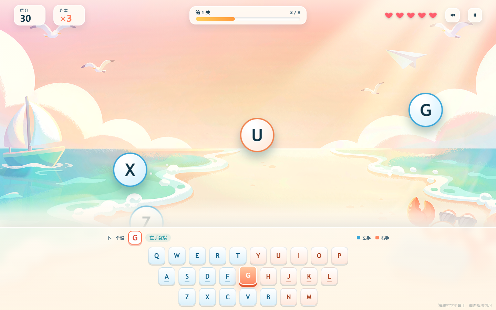

# 海滩打字小勇士 · keybubble

一个给孩子练键盘指法的小游戏。泡泡从海里飘上来，泡泡上写着字母——在键盘上敲出它，泡泡就「啵」地炸开。漏掉的泡泡会掉到沙滩上变成螃蟹，攒够五只就涨潮。

原生 HTML / CSS / JavaScript，零依赖、零后端、纯离线，双击 `index.html` 就能玩。

**在线试玩：** https://mervyn-he.github.io/keybubble/



## 玩法

- 泡泡从海面升起，敲对应字母键打爆得分；连击越高倍率越高（最高 3×）
- 连击到 5 / 10 / 15，泡泡依次镀金边、套彩虹环、触发屏幕边缘脉冲；每次打爆都会飘出得分数字并轻微震屏
- 泡泡飘到顶部不会立刻扣血，而是落到沙滩上变成一只螃蟹。攒够 **5 只**就涨潮，扣 1 颗心并清场；5 颗心掉光结算
- 每 **18 秒**一波，波间休息 4 秒（横幅提示 + 海鸥横穿）；波次越高泡泡飘得越快
- 打得快，泡泡来得也快：场上少于 3 个时自动加速补充，连击 10 以上再提一档
- `Esc` 暂停，`Enter` 开始 / 重开，鼠标点击屏幕键盘也能打（适合平板）

## 三个模式

| 模式 | 内容 | 目的 |
| --- | --- | --- |
| 入门 · 基准键 | 只用 `A S D F J K L` | 先把手指放回基准位 |
| 挑战 · 全部字母 | `A` — `Z` | 认全 26 个字母键 |
| 高手 · 单词 | 39 个 3–6 字母常见词 | 按顺序敲完整个词 |

## 教学设计

这部分是这个项目跟「披着游戏皮的按键练习」的区别：

- **弱键加权出题**：记录每个键的敲错次数，错 1 次权重升到 1.5 倍、2 次以上 2 倍；场上没有弱键时强制补一个，保证一定练得到。打对时权重缓慢衰减，练好了自动退出名单。结算页会列出这一局最需要练的键
- **屏幕键盘按左右手双色分区**：左手蓝、右手橙，泡泡描边颜色与出手手指一致，孩子一眼知道用哪只手
- **基准键标记**：`A S D F` / `J K L` 键位下有横线，回家键位随时可见
- **下一个键大号提示 + 中文手指名**（如「左手无名指」），对应键位脉冲高亮
- **同屏不重复字母**，避免"该敲哪个"的歧义
- **单词模式优先锁定打了一半的词**，提示不会跳到旁边新冒出的泡泡，打断节奏
- 音效全部由 WebAudio 实时合成，不含任何音频文件，可静音并记忆设置

## 运行

```bash
# 方式一：直接打开
双击 index.html

# 方式二：本地静态服务器（可选）
python -m http.server 8000
```

## 打包成单文件

把 CSS、JS、背景图内联成一个 HTML，方便发给别人或拷到平板上：

```bash
python tools/build-single.py
# 输出：海滩打字小勇士-单文件版.html
```

> 单文件版是构建产物，不要直接改它——改源码后重新跑脚本。

## 目录结构

```
index.html              入口
css/style.css           样式
js/game.js              游戏逻辑（单文件 IIFE，无模块依赖）
assets/bg-beach.png     游戏背景
tools/build-single.py   单文件打包脚本
docs/                   README 截图
```

## 技术说明

- 渲染：DOM + `requestAnimationFrame`，泡泡用 `translate3d` 位移，避免布局抖动
- 音效：WebAudio `OscillatorNode` 实时合成，无外部资源
- 数据：最高分按模式记录，外加每个键的错误计数，全部存在 `localStorage`，不上传任何数据
- 兼容：Chrome / Edge / Safari 现代版本，最小适配 1024×700

## 已知限制

- 只支持字母键 `A`–`Z`，不含数字、符号、空格
- 背景图右下角带 AI 生成标识，正式分发前建议裁切
- 无账号、无云端同步、无练习时长曲线（只有按键粒度的错误计数）

## License

[MIT](LICENSE) © 2026 mervyn-he
